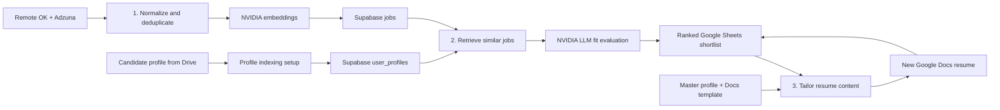

# AI Job Matching & Resume Automation

**Three n8n workflows that turn job listings into a ranked shortlist and tailored Google Docs resumes.**


This portfolio project combines API-based job discovery, vector search over candidate and job documents, evidence-based LLM fit evaluation, and resume generation. The workflows use Supabase and Google Sheets as handoffs rather than calling each other automatically.

## Architecture



## Included workflows

| Workflow | Purpose | Output |
| --- | --- | --- |
| [01 — Job discovery](workflows/01-job-discovery.json) | Fetch Remote OK and Adzuna results, normalize fields, deduplicate, and embed documents | Job documents in Supabase `jobs` |
| [02 — Candidate matching](workflows/02-candidate-matching.json) | Retrieve jobs from profile chunks, evaluate fit, combine listing metadata, and sort scores | Google Sheets rows with `fit_score > 50` |
| [03 — Resume tailoring](workflows/03-resume-tailoring.json) | Read shortlisted jobs and the master profile, generate tailored content, copy a Docs template, and replace placeholders | Resume link written back to the matching sheet row |

The original node layout and all 49 nodes are retained. These are inactive, sanitized exports that need your own credentials and resources after import.

## What this project demonstrates

- **Two-stage matching:** embedding similarity selects candidate jobs; a separate LLM evaluates skill overlap, experience, seniority, and stated requirements.
- **Structured results:** evaluations include source identifiers, a 0–100 fit score, an explanation, red flags, and an `apply`, `review`, or `skip` recommendation.
- **Grounded resume prompts:** tailoring is constrained to information in the master profile and retains three project sections.
- **Cross-service automation:** Remote OK, Adzuna, NVIDIA NIM, Supabase, Google Drive, Sheets, and Docs are connected in one documented pipeline.
- **Reusable templates:** generated content fills a copied Google Docs template, preserving its formatting.

## Repository layout

```text
workflows/
  01-job-discovery.json
  02-candidate-matching.json
  03-resume-tailoring.json
docs/
  setup.md
  credentials.md
  export-notes.md
examples/
  candidate-profile.txt
  resume-template.md
  job-tracker-headers.csv
```

## Getting started

1. Import each JSON file into n8n using **Import from File**. Use a release that supports the exported node versions, including the NVIDIA embeddings/chat and Supabase Vector Store nodes.
2. Create your own Adzuna, NVIDIA, Supabase, and Google credentials. See the [node-by-node credential map](docs/credentials.md).
3. Prepare the Supabase tables, candidate profile, Google Sheet, and Docs template using the [setup guide](docs/setup.md).
4. Replace every `YOUR_...` resource ID in the imported nodes, then run the profile-indexing setup branch once.
5. Run workflow 1, then workflow 2, inspect the shortlist, and run workflow 3 on a small set of rows.

The workflows use JavaScript **Code** nodes and cloud API calls. They do not require local Python scripts, Execute Command, or local file-access settings.

## Default behavior

| Setting | Default in the exports |
| --- | --- |
| Adzuna search | Great Britain, page 1, 20 results per search term |
| Search terms | AI, machine learning, Python, backend, software, data, and DevOps roles |
| Embedding model | `nvidia/nv-embedqa-e5-v5` |
| Chat model | `nvidia/nemotron-3-nano-30b-a3b` |
| Job retrieval | Top 9 vector matches per candidate-profile chunk |
| Sheet inclusion | Strictly greater than 50 fit score |
| Job metadata lookup | Up to 1,000 rows from `jobs` |
| Resume generation | All rows returned by the configured Sheets read node |

Provider models and API availability must be checked in your own accounts. Scores and generated text require review; prompts do not guarantee accuracy or prevent unsupported claims in every response.

## Current implementation limits

- Each workflow starts manually. Scheduling and automatic cross-workflow execution are not configured.
- The candidate-profile indexing branch in workflow 2 is separate from its main trigger; follow the setup guide to run it before matching.
- Deduplication is local to workflow execution. Repeated indexing or shortlist runs can insert duplicates unless you add persistent deduplication.
- Matching and row updates primarily use `source_id`; IDs can collide across different job providers. A production version should use a composite source and ID key.
- Workflow 3 receives the title, company, fit explanation, and red flags from the sheet, rather than the full original job description. Tailoring detail is limited by that context.
- Workflow 3 has no completed-row filter, so rerunning it can create another document for the same job. Filter rows with an empty `Tailored Resume` cell before repeat runs.
- JSON is parsed in Code nodes; strict schema validation, provider retries, and end-to-end execution tests are not included.
- Database SQL and private candidate data are not exported. Your Supabase matching function must query the `jobs` table and use the same embedding dimension as the selected model.

## Sanitization and validation

Hardcoded Adzuna authentication, n8n credential references, private Google resource IDs, cached resource links, and instance metadata were removed. Resource IDs use descriptive placeholders. Adzuna authentication now belongs in an n8n Custom Auth credential.

Checked: JSON syntax, graph references, node preservation, JavaScript syntax, and removal of original private values. The workflows have not been executed against live accounts. See [export notes](docs/export-notes.md) for the small configuration adjustments.

## Author

Built by [Faraz Ahmad Siddiqui](https://github.com/faraz020), an AI automation developer working with n8n, Python, RAG, and API integrations. [Connect on LinkedIn](https://www.linkedin.com/in/faraz-siddiqui/) to discuss workflow automation projects.
